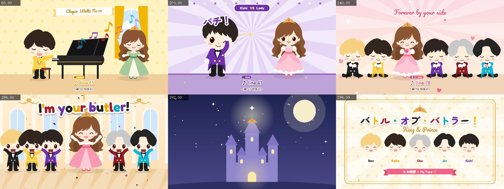

# Battle of Butler MV · MG Animation

A fan-made motion-graphics (MG) animation MV for King & Prince 「バトル・オブ・バトラー！」 —
**rendered entirely in code** with HTML5 Canvas 2D. No video editor, no keyframe software:
every frame is a pure function `renderAt(t)` of the song time, so the same code drives both
an interactive HTML player and a frame-perfect 1080p/30fps MP4.

为 King & Prince「バトル・オブ・バトラー！」制作的粉丝向 MG 动画 MV。全部画面由 Canvas 2D 代码实时绘制，
同一套代码既能在浏览器中边放边看，也能逐帧渲染成 1080p MP4。



> ⚠️ **This repository contains no song audio and no full lyrics.** They are copyrighted by their
> owners. `src/lyrics.example.js` keeps the original timing / singer layout with placeholder text.
> 仓库**不包含歌曲音频和完整歌词**（版权归原权利人所有），只提供带原时间轴的占位歌词。

## Features

- ~5 minutes, 60+ storyboarded scenes, 5 butlers + 1 lady with per-lyric facial expressions
- Deterministic renderer: seek to any time and get the exact same frame
- Beat-synced animation (beat grid detected from the audio, see `tools/beat*.js`)
- Karaoke lyric overlay with per-singer colour badges + Chinese translation line
- Parallel offline renderer: N headless-Chrome workers → x264 segments → concat + mux audio
- Single-file HTML build with fonts (and optionally audio) embedded

## Requirements

- Node.js 18+
- Google Chrome / Chromium / Edge (set `CHROME_PATH` if it is not auto-detected)
- `ffmpeg` on `PATH` (only for MP4 rendering)

```bash
npm install
```

## Usage

```bash
# 1. (optional) put your own audio here – a legally obtained copy of the song
#    assets/song.m4a
# 2. (optional) copy the example lyrics and fill in the text
#    cp src/lyrics.example.js src/lyrics.js

node build.js            # -> out/index.html  (single file, open in a browser; Space = play/pause)
node build.js --dev      # -> out/dev.html    (references assets/ instead of embedding)

node tools/shot.js demo --cols 3 60 200 286     # contact sheet of frames -> tmp/shot_demo.jpg
node tools/render.js --workers 8                # full MP4 -> out/mv.mp4
node tools/render.js --from 280 --to 299 --out out/ending.mp4
```

Without `assets/song.m4a` everything still works: the player is silent and the MP4 has no audio track.
Without `src/lyrics.js` the build falls back to `src/lyrics.example.js`.

## Project structure

```
build.js              bundle src/*.js + fonts (+ audio) into out/index.html
src/core.js           canvas helpers, easing, timing (seg / pop / tw), scene system, transitions
src/art.js            vector character artwork (traced paths)
src/chars.js          butler / lady rigs: pose, arms, faces & expressions
src/props.js          backgrounds and props (ballroom, castle, night room, hearts, petals…)
src/scenes1-4.js      the storyboard, scene by scene on the song timeline
src/lyrics.example.js lyric timing with placeholder text
src/main.js           player UI + render entry (renderAt)
tools/render.js       parallel MP4 renderer
tools/shot.js         preview contact sheets
tools/beat*.js        beat / onset analysis helpers
tools/trace.js, palette.js, scan.js, win.js  artwork tracing helpers
```

Writing a scene:

```js
scene(222.76, 233.35, (t, lt) => {          // absolute song time t, local time lt
  nightRoom(t, '#2b3566', '#55579a');
  bt('K', t, { x: 1250, y: 900, flip: true, face: fc('happy', 'open', { blush: .6 }) });
  ld(3, t, { x: 740, y: 900, face: fc('half', 'wavy', { sweat: 1 }) });
}, { tr: 'fade', td: .6 });
```

## Credits & license

- **Code** (everything in `src/` except `art.js`, `tools/`, `build.js`): [MIT](LICENSE)
- **Character designs** (`src/art.js`, the butler & lady artwork): © **Astra**.
  Used with permission. **Not** covered by the MIT license — see [NOTICE](NOTICE).
- **Fonts** (`fonts/`): Fredoka, Pacifico, ZCOOL KuaiLe, Zen Maru Gothic — SIL Open Font License 1.1
  (license texts in `fonts/`).
- **Song** 「バトル・オブ・バトラー！」 by King & Prince — all rights belong to the respective rights holders.
  This is an unofficial, non-commercial fan work and is not affiliated with the artist or label.
